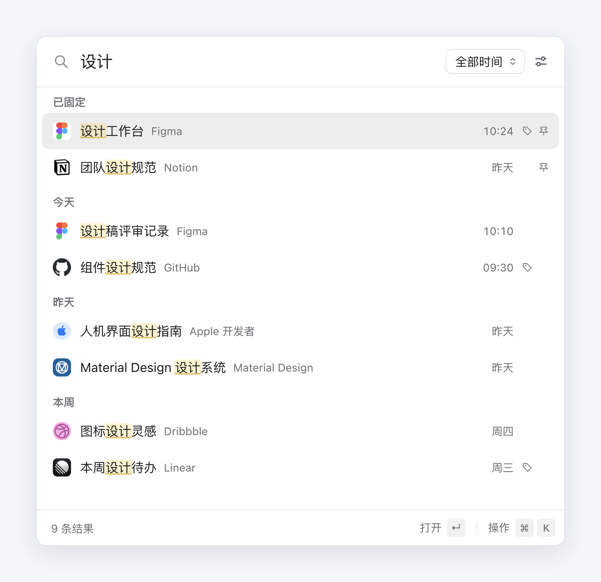
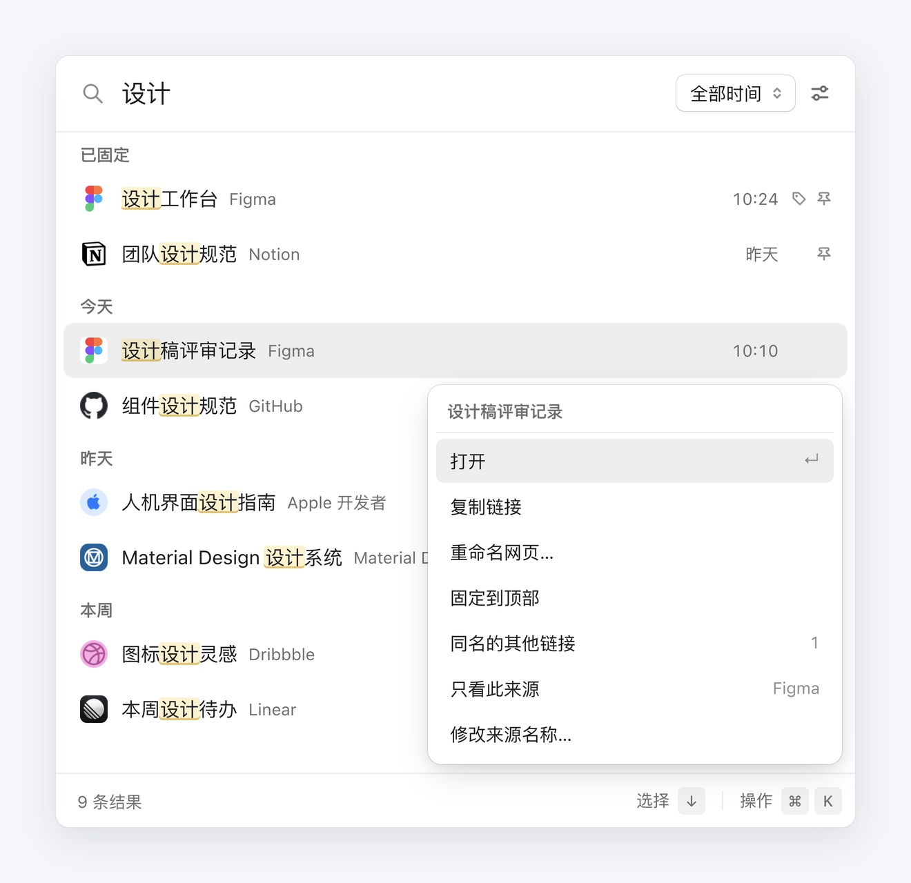

<p align="center">
  
</p>
<h1 align="center">喵迹</h1>
<p align="center">找回看过的页面，少一点重复，多一点清爽。</p>
<p align="center">
  
  
</p>
<p align="center">
  <a href="#快速开始">快速开始</a>&nbsp;&nbsp;
  <a href="#快捷键">快捷键</a>&nbsp;&nbsp;
  <a href="#数据与备份">数据与备份</a>&nbsp;&nbsp;
  <a href="https://github.com/0xb3i/chrome-history-dedupe/issues">反馈问题</a>
</p>

喵迹是一款 Chrome 历史记录搜索扩展。按下快捷键，用记得的标题或曾用名找回页面，自动归并重复链接，也能给常用页面改名、固定。

<p align="center">
  
</p>
<p align="center"><sub>使用示例数据展示已重命名、已固定、时间分组、来源标签与关键词高亮。</sub></p>

## 功能

- **标题与曾用名搜索**：输入即搜索，关键词高亮；记不清当前标题时，也可以试试页面以前的名字。
- **减少重复结果**：同一页面的重复 URL 自动归并，同一来源的同名页面折叠展示，其他链接可在操作面板中查看。
- **重命名与固定**：为页面起一个好记的名字，把常用页面固定到结果顶部。
- **筛选与排序**：按时间、来源或是否已命名筛选，支持综合排序、访问最多、最近访问和名称排序。
- **键盘操作**：方向键选择结果，回车打开；通过操作面板完成重命名、固定、复制链接等操作。

<details>
<summary>查看操作面板</summary>

选中结果后按 ⌘K / Ctrl+K，或右键点击结果。

<p align="center">
  
</p>

</details>

## 快速开始

需要 **Chrome 105 或更新版本**。直接加载项目目录即可使用，无需构建或安装 Node.js。

1. [下载 ZIP](https://github.com/0xb3i/chrome-history-dedupe/archive/refs/heads/main.zip) 并解压到固定目录，也可以使用 Git：

   ```bash
   git clone https://github.com/0xb3i/chrome-history-dedupe.git
   ```

2. 打开 `chrome://extensions`，开启右上角的「开发者模式」。
3. 点击「加载已解压的扩展程序」，选择包含 `manifest.json` 的项目根目录。
4. 将「喵迹」固定到工具栏，点击小猫图标，或按下方快捷键开始搜索。

首次打开时会建立本地搜索索引，历史记录较多时需要稍等。Chrome 原生历史记录页面仍可正常使用。

**更新**：在原目录更新文件，再到 `chrome://extensions` 点击「重新加载」。使用 Git 安装时，先在项目目录运行 `git pull`。

## 快捷键

| 操作 | macOS | Windows / Linux |
| --- | --- | --- |
| 打开搜索 | Option + S | Alt + S |
| 重命名当前网页 | Option + Shift + S | Alt + Shift + S |
| 打开结果的操作面板 | ⌘ + K | Ctrl + K |
| 选择结果 | ↑ / ↓ | ↑ / ↓ |
| 打开选中的页面 | Enter | Enter |

前两项是默认建议值，可在 `chrome://extensions/shortcuts` 修改。喵迹设置页会显示实际生效的快捷键。

## 数据与备份

- **本地保存**：历史搜索索引、页面名称和固定状态保存在本机，不上传、不跨设备同步。
- **保留原始历史**：去重只影响结果展示，不删除 Chrome 历史记录；扩展不在无痕模式中运行。
- **重命名的范围**：已命名页面不受时间筛选限制，但仍需要对应页面存在于 Chrome 历史中。

在搜索面板打开「筛选与排序」→「设置」，使用「导出」或「恢复」管理备份。备份包含页面名称、来源名称、固定状态和自动采集的标题，不包含 Chrome 原始历史。

移动加载目录、卸载或重新安装扩展前，请先导出备份，避免扩展 ID 变化后无法访问原有本地数据。

## 开发与贡献

扩展使用原生 HTML、CSS 和 JavaScript，无运行时框架依赖。开发验证需要 Node.js 20.19 或更新版本，建议使用当前 LTS。

```bash
npm ci
npm run verify
```

`verify` 包含单元测试、页面交互测试、语法及 Manifest 检查。修改后，在 Chrome 扩展管理页重新加载即可使用。

欢迎通过 [Issues](https://github.com/0xb3i/chrome-history-dedupe/issues) 提交问题或建议。反馈问题时，请附上 Chrome 版本、扩展版本和复现步骤；提交代码前请运行 `npm run verify`。

## 致谢

小猫图标来自 Microsoft [Fluent Emoji](https://github.com/microsoft/fluentui-emoji)，沿用原始橙色设计，图标素材使用 [MIT 许可证](icons/LICENSE)。
